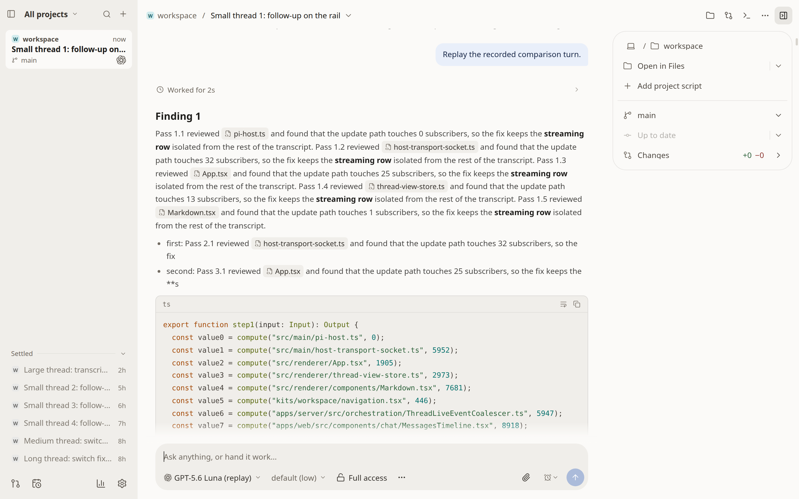

# Tau and T3 Code: Linux production comparison, 2026-10-17

Tau started sooner and showed warm threads sooner in this fixture. T3 initially
streamed much more smoothly. Tracing identified a Tau CSS invalidation cost;
bounding the affected elements removed that cost in a Chromium regression probe
and improved the alternating production replay below. This is one Linux/X11
machine with synthetic conversations, not a release benchmark or a comparison
of model quality.

## Revisions and method

- Before: Tau `324e2ba2b3b6b0156df56efa0514e905a0708637`, Electron 44.4.4.
- After: Tau `08ed2a4b64b8b9aa675cbd4ffde6ad90a90d47e5`, Electron 44.4.4.
- Reference: [T3 Code `d5b7095a`](https://github.com/pingdotgg/t3code/commit/d5b7095a097101ace362fa88003fff4c6f44200b), Electron 44.4.5.
- Production bundles, unpackaged Electron, Linux x64, i5-9600K, six logical
  cores, 60 GiB memory; Xvfb 1440×900, device scale factor 2.
- Both apps ran in background mode, with the sandbox disabled explicitly for
  these isolated local tests. Product launch and CI sandbox policy are unchanged.
- Owned `/tmp` homes and seeded profiles; no real app data, accounts or model
  calls. The fake Codex turn has 899 events, 151,490 text bytes, 20 code fences,
  six tools and a scheduled duration of 14,384 ms. The shared Codex history has
  seven threads, including 6-, 30- and 100-turn histories. Tau also imports three
  Pi histories for its separate switch scenarios.
- The full before series alternated apps across five measured runs plus one
  excluded warm-up each. The full after series measured Tau only, with the same
  sample counts. No builds or focused tests ran during measurement. OS caches
  were not flushed.

The raw [before](compare-linux-2026-10-17-before.json) and
[after](compare-linux-2026-10-17-after.json) reports retain individual runs,
launch conditions, fixtures and process accounting. See the
[Linux reproduction guide](comparison-linux.md).

## Current app comparison before the CSS fix

Values are medians; time is milliseconds. Warm switch medians use 15 switches
per history size, all other rows use five runs. A frame p95 is computed within
each streamed turn, then summarized across runs.

| Observation | Tau before | T3 Code |
| --- | ---: | ---: |
| Spawn to rail and composer ready | 2,897 | 8,237 |
| Spawn to first paint | 792 | 7,115 |
| Cold short / medium / long thread visible | 116 / 276 / 162 | 118 / 226 / 140 |
| Warm short / medium / long thread visible | 75 / 79 / 71 | 96 / 103 / 98 |
| Warm medium / long thread settled | 143 / 145 | 103 / 98 |
| First streamed text visible | 216 | 359 |
| Stream frame p95 | 83.3 | 16.8 |
| Stream long-task count / total time | 88 / 6,401 | 2 / 763 |
| Process-tree RSS, idle / after turn, MiB | 1,212 / 1,629 | 1,172 / 1,328 |

Tau's earlier warm visibility did not mean earlier settlement for medium and
long threads. Pi medium/long cold settlement was also slower within Tau
(591/492 ms); it has no matching T3 measurement here. These remain useful
follow-up targets. RSS sums include shared pages and different helper/fixture
sets; they are footprint observations, not a runtime memory-efficiency ranking.
Linux `ps` CPU counters resolved to whole seconds, so five-second idle samples
are too coarse to interpret Tau's reported zero as zero CPU consumption.

## Measured CSS cost and change

A renderer CPU profile first pointed at visible-turn geometry reads. Removing
that work moved the cost into browser rendering and did not improve the replay.
A Chrome timeline instead showed roughly 7.2 seconds in `UpdateLayoutTree`
versus 0.3 seconds in layout. Removing all loaded `:has()` rules experimentally
restored a roughly 16.8 ms stream p95. Invalidation tracing then identified broad
wildcard and `span` subjects in focus, fresh-start, header, PR-strip and send-mode
rules. This diagnosis uses Chrome's
[style recalculation and selector tooling](https://developer.chrome.com/docs/devtools/performance/selector-stats).

The change limits those subjects to named elements. A real Chromium probe
appends ten tokens beside 3,000 settled spans using the actual stylesheets:
**before, 3,009–3,017 elements recomputed per token; after, at most three**.
This structural assertion avoids a machine-speed threshold. Browser checks also
cover transcript scrolling at 360/620/900 px, native keyboard and pointer focus,
image-only and extension-block-only messages, fresh-start visibility/restoration,
header drag space, folded/scrolling PR strips and iconless send labels.

## Alternating production replay

The full after batch encountered substantially higher unrelated host load:
median one-minute load at launch was 8.1, range 3.0–17.3, versus the before
Tau batch's 2.5, range 1.8–3.2. Its five stream p95 values were 125.8, 90.0,
16.8, 16.8 and 16.8 ms. Keep that entire record; its median alone conceals the
contention. Startup and switch differences between those batches do not isolate
the effect of this CSS change.

To keep conditions closer, the separate replay-only series alternated before /
after and after / before over five pairs, with one excluded warm-up per version.
Both production builds used the same reset seeded profile, viewport, replay,
frame probe and transfer counter as the full harness. It omitted idle sampling,
large-history scrolling and thread-switch scenarios.

| Pair, execution order | Before stream frame p95, ms | After stream frame p95, ms | Before load, start / end | After load, start / end |
| --- | ---: | ---: | ---: | ---: |
| 1, before → after | 83.4 | 16.8 | 3.2 / 2.5 | 2.5 / 2.7 |
| 2, after → before | 83.3 | 16.8 | 2.2 / 2.9 | 2.5 / 2.3 |
| 3, before → after | 83.3 | 16.8 | 2.7 / 2.5 | 2.5 / 2.3 |
| 4, after → before | 83.3 | 16.8 | 2.7 / 2.8 | 2.3 / 2.9 |
| 5, before → after | 83.3 | 33.3 | 3 / 4.3 | 4.3 / 5.5 |

Across the five measured turns, the median frame p95 was **83.3 ms before and
16.8 ms after**. The p95 across those five per-turn p95 observations was
83.4 / 30 ms. These are separate percentile levels. The fifth after run reached
33.3 ms as load rose; it is retained. Warm-ups were 83.4 / 33.3 ms and are excluded.
The median stream long-task count fell from 89 to one, with total duration
6,614 / 56 ms. All launches completed and process cleanup found no survivors.
The [complete pair report](stream-style-pairs-2026-10-17.json) retains every result.

The measured helper revision is `63c89cb4d09b21b45d6035570f4c5a86e2cf64a6`.
Independent review caught two missing input guards in that helper: it did not
validate the seeded history or rewrite the replay file. During this measurement,
both existing files were checked against the exact intended fixtures and matched;
[this timestamped validation](stream-style-pairs-fixture-validation.json) retains
the replay SHA-256 and full history plan. The helper now validates the plan,
writes the exact replay before launching and records the plan in future reports.
The raw measurement keeps its original harness revision.

## Limits and remaining work

The paired result supports this CSS fix on this setup. It does not establish
startup, idle, memory or thread-switch improvements, nor packaged-app or
macOS/Windows/GPU behavior. Background mode, disabled local sandbox, shared-host
load and different Electron patch versions constrain cross-app conclusions.
The older Mac report cannot serve as a before measurement for these Linux runs.

The named-subject browser regression and focus/layout checks run in CI through
`smoke:transcript-scroll`. Broader lifecycle concurrency, reconnect, large-thread,
multiclient and real-device evidence remain separate adoption work.
